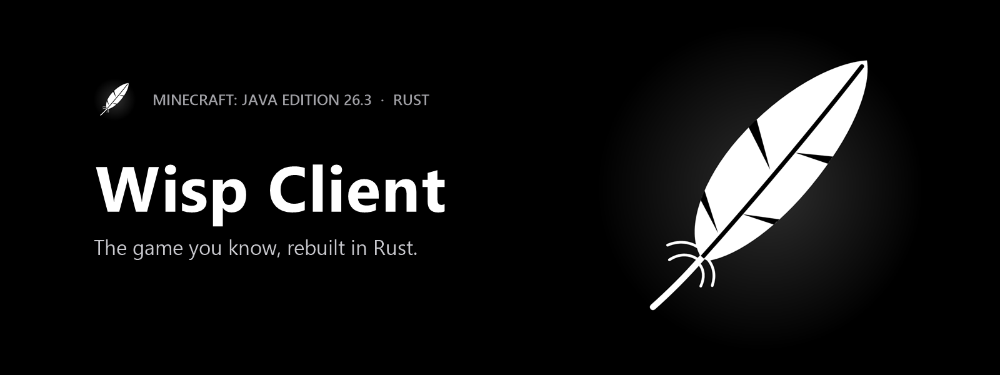
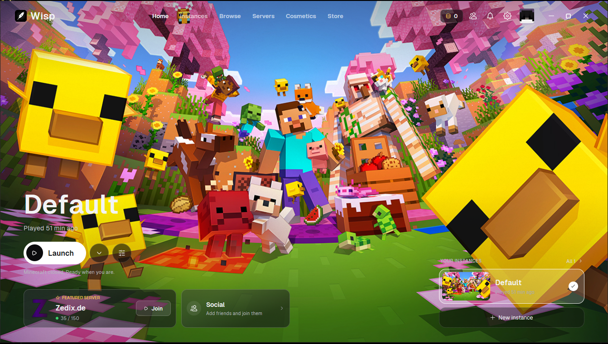
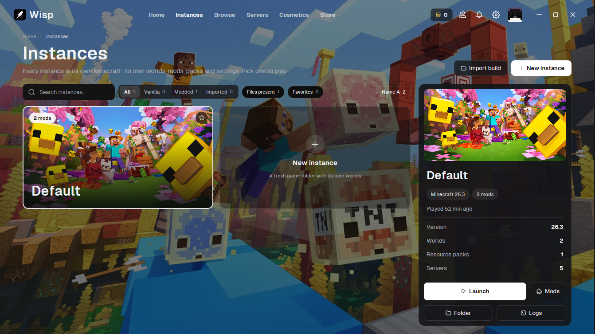
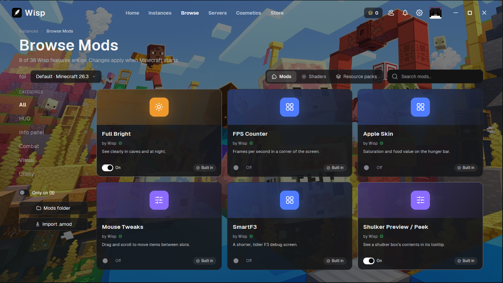
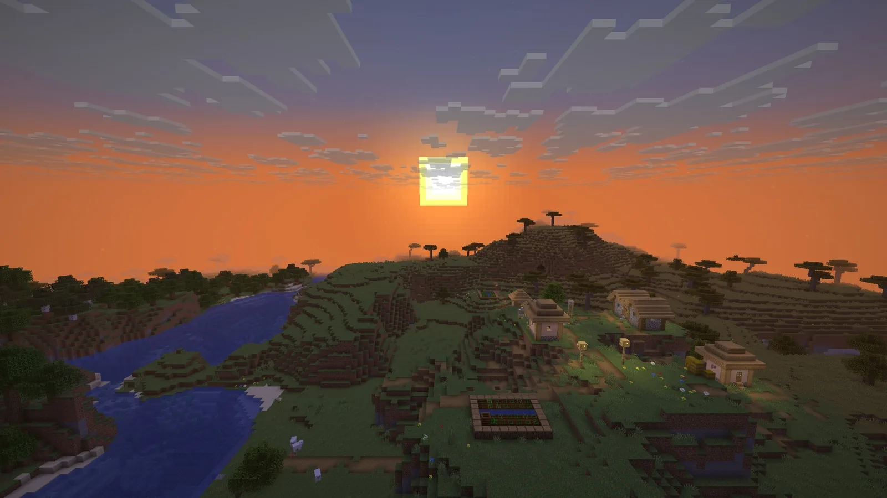
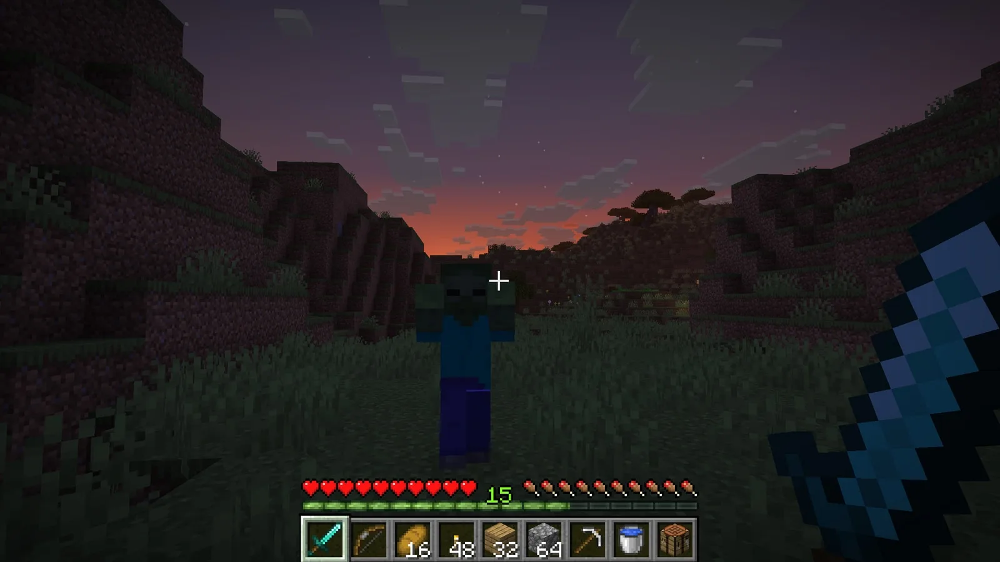
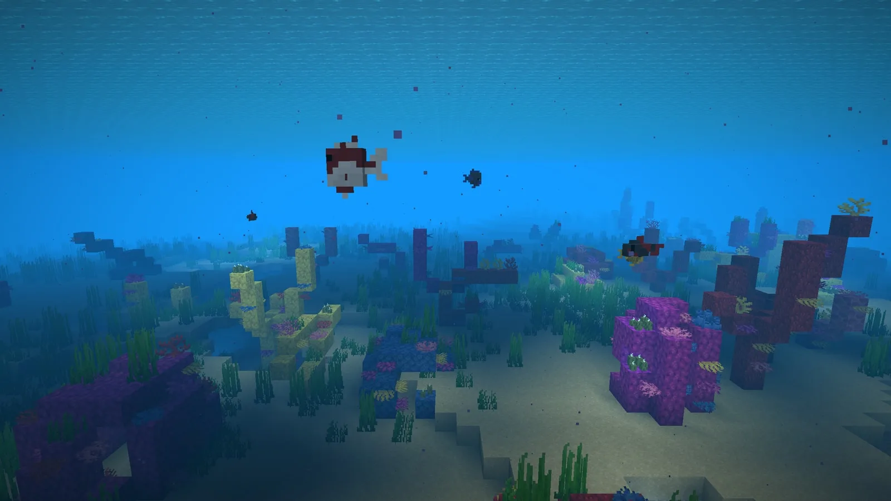
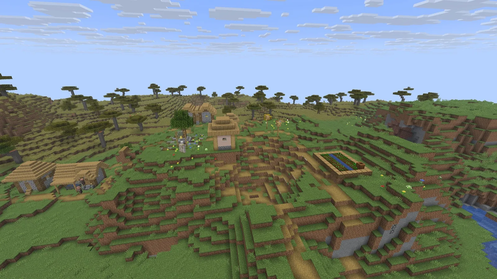
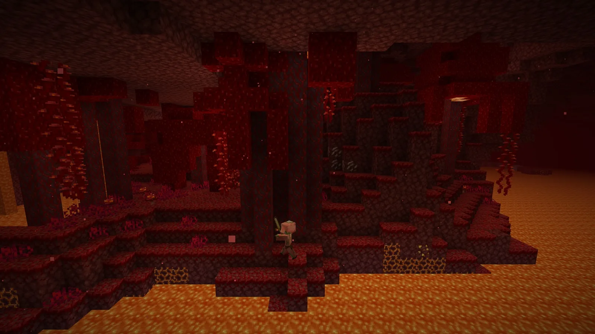

<p align="center">
  
</p>

<p align="center">
  
  
  
  
  <a href="LICENSE"></a>
</p>

<p align="center">
  <a href="#download"><b>Download</b></a> ·
  <a href="#screenshots"><b>Screenshots</b></a> ·
  <a href="#features"><b>Features</b></a> ·
  <a href="#build-from-source"><b>Build from source</b></a> ·
  <a href="docs/README.md"><b>Docs</b></a>
</p>

# Wisp Client

Wisp is a Minecraft: Java Edition 26.3 client written from the ground up in Rust, with its own
launcher. It plays your vanilla worlds and servers and adds the Wisp extras on top: built-in mods,
cosmetics, emotes, a store and the Wisp Menu. Free and open source.

> Wisp is not an official Minecraft product and is not approved by or associated with Mojang or
> Microsoft. It contains no Minecraft code or assets: you need a Microsoft account that owns
> Java Edition.

## Download

Get the Windows installer from the [releases](https://github.com/Lyvt-Dev/Wisp-Client/releases).
It installs the Wisp launcher, which signs you in with Microsoft, sets up the game from your copy
of Minecraft and keeps itself up to date.

**You need:** Windows 10 or 11 (x64), a GPU with Vulkan or DirectX 12, and a Microsoft account
that owns Minecraft: Java Edition ([why](docs/microsoft-account.md)).

## Screenshots

<table>
  <tr>
    <td colspan="2"></td>
  </tr>
  <tr>
    <td width="50%"></td>
    <td width="50%"></td>
  </tr>
</table>

In game, rendered by Wisp's Rust engine with vanilla assets:

<table>
  <tr>
    <td colspan="2"></td>
  </tr>
  <tr>
    <td width="50%"></td>
    <td width="50%"></td>
  </tr>
  <tr>
    <td width="50%"></td>
    <td width="50%"></td>
  </tr>
</table>

## Features

**Launcher**
- Microsoft sign-in, and instances that each keep their own worlds, mods, packs and settings.
- **Browse:** Wisp's built-in mods, shaders and resource packs, switched on per instance, plus
  `.amod` imports and Modrinth / CurseForge modpacks ([modpacks](docs/modpacks.md)).
- **Servers:** a featured server, your server list, and servers you host yourself
  ([hosting](docs/hosting.md)).
- **Cosmetics and Store:** capes, wings, hats, glasses, pets and emotes, a 3D preview on your own
  skin, Wisp Coins and creator codes ([cosmetics](docs/cosmetics.md)).
- **Social:** friends, and joining what they play.

**Game**
- Vanilla 26.3 gameplay, world generation, redstone, commands and multiplayer, on your existing
  saves.
- The **Wisp Menu** (Right Shift): HUD widgets, built-in mods like FPS counter, Full Bright,
  Apple Skin, Mouse Tweaks, zoom and minimap, all off by default where they change the vanilla
  look ([extras](docs/extras.md)).
- Graphics presets, distant terrain, shaders, controllers and Wisp Settings
  ([graphics](docs/graphics.md), [controllers](docs/controllers.md)).
- Native Rust mods and content mods ([mods](docs/mods.md)).
- `wisp-ctl` lets scripts and AI agents read the game's state and play it, also over MCP
  ([agent control](docs/agent-control.md)).

## Build from source

Needs Rust 1.90+, Python 3.10+ and JDK 25. `wisp-prepare` builds the game's resources from
**your own copy** of Java Edition 26.3 and never downloads it: play 26.3 once in the official
launcher, and pass the 26.3 server jar once.

```sh
git clone https://github.com/Lyvt-Dev/Wisp-Client.git
cd Wisp-Client
cargo run --release -p wisp-prepare -- --prepare --server-jar path/to/server.jar
cargo run --release -p wisp-client
```

The launcher is its own workspace in [`launcher/`](launcher/README.md); the Windows installer is
built as described in [`packaging/windows`](packaging/windows/README.md). Prepared game files land
in the gitignored `.local/`: never commit or share them. All developer docs:
[docs/README.md](docs/README.md).

## Contributing

Issues and pull requests are welcome. Read [CONTRIBUTING.md](CONTRIBUTING.md) first, and run the
self-check before a pull request:

```sh
git config core.hooksPath .githooks
python3 tools/pr_ready.py
```

## License

[MIT](LICENSE). Wisp started as a fork of an MIT-licensed Rust rewrite of Minecraft; its original
notice is kept in [UPSTREAM.md](UPSTREAM.md), and dependencies keep their own licenses
([notices](THIRD_PARTY_NOTICES.md)). Minecraft is a trademark of Mojang Synergies AB; its code and
assets belong to Mojang and Microsoft under the [Minecraft EULA](https://www.minecraft.net/en-us/eula).
